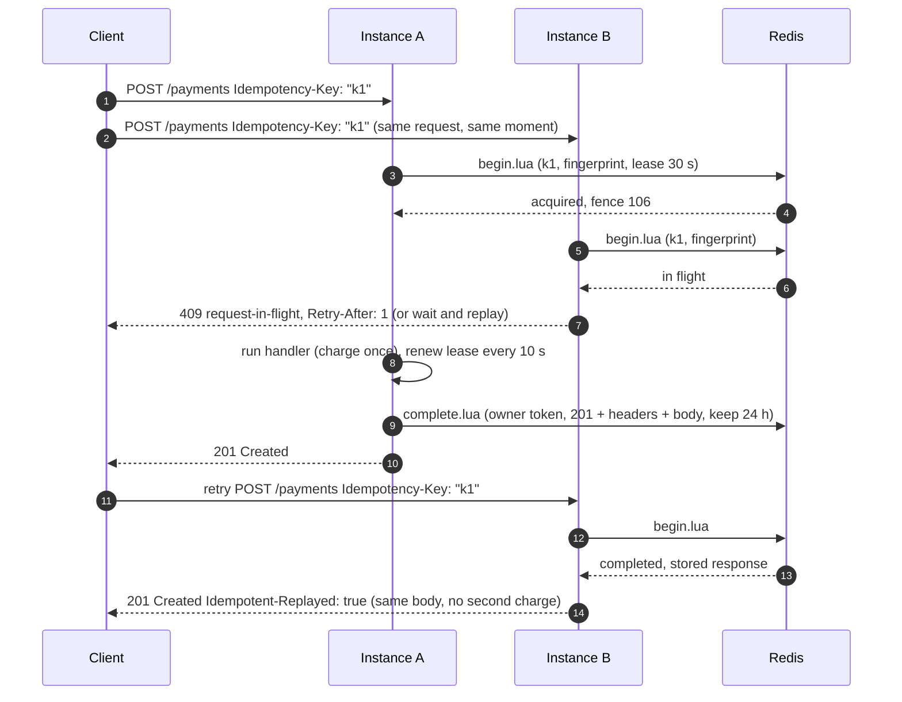
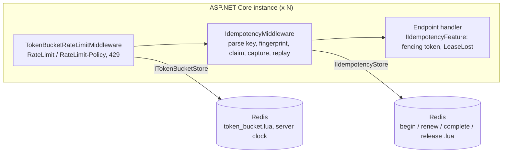

# idempotent-api

[](https://github.com/hekimcan206/idempotent-api/actions/workflows/ci.yml)
[](https://github.com/hekimcan206/idempotent-api/actions/workflows/codeql.yml)
[](LICENSE)
[](global.json)

ASP.NET Core middleware for the IETF `Idempotency-Key` header. Concurrent copies of one request run **exactly once
across all instances**, retries get the original response back, and a Redis token bucket enforces one rate limit for
the whole deployment, advertised to clients with the IETF `RateLimit` headers. It ships as two NuGet packages,
`IdempotentApi.AspNetCore` and `IdempotentApi.Redis`.

> 50 concurrent copies of a payment over two instances: **1 execution in 30 of 30 rounds**. A check-then-set Redis
> store ran the handler **4 to 15 times in every round**. A shared Lua token bucket admitted **99.7 %** of its
> theoretical bound under 32 competing workers; computing the bucket in the application admitted **17×** the bound.
> ([measurements](docs/benchmarks.md))

## The problem

A client sends `POST /payments`, and the connection drops before the response arrives. Did the charge happen? The only
safe move for the client is to retry. The only safe move for the server is to recognise the retry. Doing that
correctly is harder than it looks:

- **Concurrency is the real problem, not retries.** Hedged requests, load-balancer retries and impatient SDKs deliver
  copies of a request *at the same time*, to *different instances*. "Look up the key, then insert it" lets every copy
  see "not found". In the benchmark below, that pattern charged the same payment up to 15 times per burst.
- **Crashes.** An instance that claims a key and then dies must not block it forever. An instance that pauses
  longer than its lease must not overwrite the result of the instance that took over.
- **What to replay.** A 201 should be replayed for a day. A transient 503 should not. A `Set-Cookie` never should.
- **Key reuse.** The same key with a different body is a client bug that must be refused, not silently "deduplicated".
- **Rate limits.** A per-instance limiter admits N × the policy on N instances, and the built-in ASP.NET Core
  limiter cannot tell clients how much quota they have left.

## What this does





| Situation | Response |
|---|---|
| First request | the handler's response, captured as it streams |
| Retry after completion | the original status, headers and body + `Idempotent-Replayed: true` |
| Same key while the original is running | `409` + `Retry-After: 1` (draft behaviour), or wait and replay (`ConcurrencyMode.WaitForResult`) |
| Same key, different method/path/query/media type/body | `422` |
| Missing or malformed key | `400` |
| Original failed with 5xx or threw | key released, so the retry executes |
| Redis unreachable | `503`, nothing executed (fail closed) |
| Rate limit exceeded | `429` + `Retry-After` + `RateLimit: "payments";r=0;t=5` |

The full contract, including retention and every problem type, is in
[docs/idempotency-specification.md](docs/idempotency-specification.md). The draft requires every resource to publish
such a specification, and the error responses link to it.

## Why this design

- **One Lua script per state transition** ([ADR 0002](docs/adr/0002-atomic-lua-scripts-with-leases-and-fencing-tokens.md)).
  The claim reads and writes in one atomic step on the primary, which is the only way N instances can't all see
  "absent". A random **owner token** keeps a late writer from completing a key it no longer owns. A **lease** with
  renewal frees keys whose owner crashed. A monotonic **fencing token** is handed to the handler, because a lease
  alone cannot stop a paused process from writing; only the database can, with `WHERE last_fence < @fence`.
- **Draft semantics, strict by default** ([ADR 0001](docs/adr/0001-follow-the-ietf-idempotency-key-draft.md)). The key
  is an RFC 9651 sf-string (bare keys are opt-in), and the 400 / 409 / 422 split follows the draft. Keys are scoped
  to the caller and hashed, so client B can never replay client A's response and client bytes never become Redis key
  names.
- **409 by default, wait-and-replay as an opt-in** ([ADR 0003](docs/adr/0003-reject-concurrent-duplicates-by-default-wait-as-opt-in.md)).
  Waiters poll the same atomic script, so a failed original hands the key to a waiter instead of stranding it.
- **Store 2xx/4xx, release 5xx, fail closed** ([ADR 0004](docs/adr/0004-what-is-stored-replayed-and-when-to-fail-closed.md)).
  Replaying a transient failure for 24 h would be worse than re-running a handler that must be crash-safe anyway.
  Without the store there is no way to know whether a key has run, so the request is refused.
- **Token bucket in Lua on the Redis clock** ([ADR 0005](docs/adr/0005-distributed-token-bucket-in-lua-with-ratelimit-headers.md)).
  The deployment has one timeline whatever the host clock skew, a backwards clock step refills nothing, and the
  limiter fails open, because it protects capacity, not correctness.

## Quick start

### Run the demo

```bash
docker compose up --build
```

This starts Redis, two instances of the sample payments API (`api-a` on `127.0.0.1:58180`, `api-b` on
`127.0.0.1:58181`), and a driver that attacks both instances and exits non-zero if any scenario fails:

```text
idempotent-api demo against http://api-a:8080, http://api-b:8080
PASS  concurrent-duplicates        50 copies over 2 instances -> 201 x1, replayed x0, 409 x49; charges run: 1
PASS  retry-after-completion       first 201 on instance A, retry on instance B -> 201 replayed=True, identical body=True; charges run: 1
PASS  key-reused-other-body        same key, amount 10.00 then 9999.00 -> 422; charges run: 1
PASS  missing-key                  no Idempotency-Key -> 400; charges run: 0
PASS  wait-mode                    20 copies -> 201 x20, distinct bodies: 1; charges run: 1
PASS  shared-rate-limit            160 requests in 0.13 s over 2 instances -> allowed 101 (bound 103), 429 x59 with Retry-After; policy "payments";q=100;w=5
{"scenarios":6,"passed":6,"failures":[]}
```

Try it by hand. The charge runs on `api-a`, and the retry on `api-b` is a replay:

```text
$ curl -i -X POST localhost:58180/payments -H 'Idempotency-Key: "090bfe04-d5d8-411f-98b4-2cb79397f63f"' \
       -H 'X-Client-Id: readme' -H 'Content-Type: application/json' \
       -d '{"amount":"125.50","currency":"TRY","merchantReference":"order-1001"}'
HTTP/1.1 201 Created
Location: /payments/pay_ef4c5c8432f340419c4e
RateLimit-Policy: "payments";q=100;w=5
RateLimit: "payments";r=99;t=1
{"paymentId":"pay_ef4c5c8432f340419c4e","amount":"125.50","currency":"TRY","merchantReference":"order-1001","chargedBy":"api-a","fencingToken":106,"chargedAt":"2026-11-12T08:54:49.6219121+00:00"}

$ curl -i -X POST localhost:58181/payments ...same key, same body...
HTTP/1.1 201 Created
Location: /payments/pay_ef4c5c8432f340419c4e
Idempotent-Replayed: true
{"paymentId":"pay_ef4c5c8432f340419c4e", ... "chargedBy":"api-a","fencingToken":106, ...}

$ curl -i -X POST localhost:58180/payments ...same key, "amount":"999.00"...
HTTP/1.1 422 Unprocessable Entity
{"type":"https://github.com/hekimcan206/idempotent-api/blob/main/docs/idempotency-specification.md#key-reused","title":"Idempotency-Key is already used","status":422,...}
```

`GET /ledger` shows how many charges really ran. The API reference is served at `/scalar`.

### Use the library

```csharp
builder.Services.AddIdempotency(o => o.PartitionResolver = ctx => ctx.User.FindFirstValue("client_id") ?? "anonymous");
builder.Services.AddRedisIdempotencyStore("redis:6379");                   // omit for the in-memory store (single instance)

builder.Services.AddTokenBucketRateLimiting(o => o.AddPolicy("payments", capacity: 100, refillPerSecond: 20));
builder.Services.AddRedisTokenBuckets("redis:6379");

app.UseRouting();
app.UseAuthentication();
app.UseTokenBucketRateLimiting();   // before idempotency: retries spend quota too
app.UseIdempotency();

app.MapPost("/payments", Charge)
   .RequireIdempotency()                                                  // draft behaviour: 409 for in-flight duplicates
   .RequireTokenBucket("payments");
app.MapPost("/transfers", Transfer)
   .RequireIdempotency(p => p.ConcurrencyMode = ConcurrencyMode.WaitForResult);
```

Inside a handler, `HttpContext.Features.Get<IIdempotencyFeature>()` exposes the key, the fencing token and a
`LeaseLost` cancellation token. Register the meter and activity source `IdempotencyTelemetry.Name` with
OpenTelemetry to get `idempotency.requests{outcome}`, `idempotency.wait.duration` and `ratelimit.decisions{policy,result}`.

The packages are built and smoke-tested in CI: a fresh `dotnet new web` project consumes them from the local feed.
CI keeps them as a build artifact. They are not published to nuget.org yet.

## Results

Measured on a shared Windows workstation (i7-13620H) with Redis in Docker Desktop. The details, method and raw JSON
are in [docs/benchmarks.md](docs/benchmarks.md).

| What | Result |
|---|---|
| 50 concurrent copies × 30 rounds, 2 instances: handler executions per round | **Lua store: 1 (min 1, max 1)**; check-then-set: 9 (4-15); no middleware: 50 |
| Wait mode, 50 copies of a 100 ms operation | 1 execution per round, all 201 with one body; p50 128.5 ms, max 228.4 ms |
| Shared bucket, capacity 50 + 100/s, 3 s, 4 instances × 8 workers (bound 350) | **Lua: 349 (99.7 %)**; get-compute-set: 6,086 (1,738 %); per-instance memory: 1,400 (400 %) |
| Redis round trips, p50 | claim 0.96 ms, complete 0.87 ms, replay 0.88 ms, bucket take 0.95 ms (`PING` 0.85 ms) |
| End-to-end, trivial endpoint, 16 clients | no middleware 40.6-52.5k req/s; in-memory store 24.1-29.3k; Redis new keys 4.5-6.1k (p50 2.4-3.1 ms); Redis replays 5.2-9.7k |
| Per-request CPU | key parse 80 ns, fingerprint 1.1 µs per KiB, storage key 0.34 µs |
| Fix found by benchmarking | lease renewal threw an exception per request; in-memory throughput went from 39-47 % to 56-59 % of baseline |

## Tests

139 tests: 109 unit (`tests/IdempotentApi.UnitTests`) and 30 integration (`tests/IdempotentApi.IntegrationTests`).

- **Store contract**: one set of assertions (claim, in-flight, mismatch, owner-only complete/renew/release, larger
  fencing token after release, takeover after the lease expires, retention expiry, 64 concurrent claims → 1 lease).
  It runs against the in-memory store and against Redis 7 through Testcontainers.
- **Middleware**: every row of the response table above, including streaming through `BodyWriter`, cookies not
  replayed, partition isolation, oversized bodies, lease renewal under a slow handler, lease loss, and 200 concurrent
  requests → 1 execution.
- **Property tests (FsCheck)**: the token bucket never admits more than `capacity + rate × T` over any interval;
  tokens stay in `[0, capacity]`; a request retried exactly at `Retry-After` succeeds; the reset time refills the
  bucket. sf-string formatting and parsing round-trip, and the parser never throws on arbitrary input.
- **Golden files**: all seven idempotency error bodies and the 429 body.
- **Multi-instance (Redis)**: 4 hosts × 100 copies → 1 charge; wait mode across 3 hosts → 30 identical bodies;
  a crashed owner blocks a key only until its lease lapses, and its late write is refused; a Redis outage gives 503
  with nothing charged; 8 connections × 25 raw claims → 1 lease; the rate limit holds across 2 hosts; Lua and C#
  bucket arithmetic agree.
- **Demo as a test**: the compose demo's six scenarios run against two in-process instances of the sample API.

```bash
dotnet test        # Docker must be running for the integration tests
```

## Limitations and next steps

- **Redis failover can lose a fresh claim.** Replication is asynchronous, so a promoted replica may not have a claim
  the old primary just granted, and a retry executes again. `WAIT 1` after the claim would narrow this window at the
  cost of latency. It is not implemented. Fencing tokens let the database reject the older writer.
- **Redis Cluster:** the claim script touches the record key and the fencing counter. Both must hash to the same slot
  (give `FenceKey` and `KeyPrefix` a common `{hash tag}`), which concentrates idempotency traffic on one shard.
- **The guarantee is "the handler runs at most once per key while Redis is consistent".** If Redis fails in the
  narrow window after the handler ran but before `complete`, the lease lapses and a retry runs again. This is logged
  as an error.
- **Bodies are compared byte for byte.** Re-serialised JSON with different whitespace is a 422. Plug in an
  `IRequestFingerprinter` for semantic comparison.
- **Stored responses are not encrypted** in Redis. Use Redis ACLs and TLS, and keep secrets out of idempotent responses.
- **Wait mode polls** (5-100 ms backoff). It is fine for short handlers; long-running work should return 202 and a
  status resource instead.
- **The rate limiter is its own middleware**, not a `System.Threading.RateLimiting.RateLimiter`, because the built-in
  middleware does not expose remaining quota. It does not compose with `[EnableRateLimiting]`.
- Both IETF documents are still drafts (idempotency-key -07, ratelimit-headers -11). Field syntax may change before
  they become RFCs.
- Not measured: Redis on another host or a managed service, Linux host numbers, failover behaviour, and long soak runs.
- Next: optional `WAIT`-based durability for claims, a PostgreSQL store that commits the claim inside the business
  transaction, and publishing the packages to nuget.org.

## Privacy

All data is synthetic; no real personal or payment data. The sample's amounts, merchant references and client ids are
generated by the demo driver and tests. Stored responses can contain personal data in real deployments. See the
threat model ([docs/threat-model.md](docs/threat-model.md)) for retention, scoping and encryption guidance, for example
under KVKK (Türkiye's personal data protection law) or the GDPR.

## Repository layout

```text
src/IdempotentApi/            middleware, sf-string parser, fingerprint, in-memory stores, token bucket, RateLimit headers
src/IdempotentApi.Redis/      Redis stores; Lua scripts in Scripts/ are embedded resources
samples/PaymentsApi/          sample API (Serilog JSON logs, OpenTelemetry, health checks, Scalar)
samples/DemoDriver/           compose demo driver (also run by the integration tests)
tests/                        unit + property + golden tests, Testcontainers integration tests, shared store contract
benchmarks/                   scenario harness and BenchmarkDotNet micro-benchmarks; results in benchmark-results/
docs/                         ADRs, idempotency specification, threat model, benchmarks
```

## License

[MIT](LICENSE)
